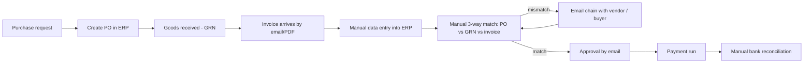
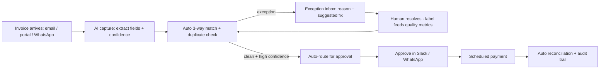
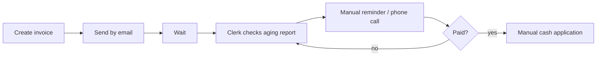
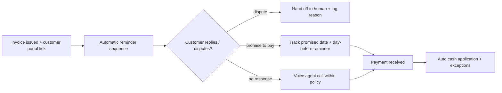

# 06 - Process mapping: AS-IS vs TO-BE for Procure-to-Pay and Invoice-to-Cash

Product managers for finance automation must map how work happens today (AS-IS), where it breaks, and what the agentic version (TO-BE) should do, including where humans stay in control. This project does that for two core finance flows, and ranks which steps to automate first.

Based on general finance-operations practice and public descriptions of AP/AR automation. Time and volume figures in `opportunity_scoring.py` are **assumptions** to show the method; real values come from customer discovery (see project 08).

## A. Procure-to-Pay (accounts payable)

### AS-IS (manual)

Pain points: re-keying invoice data (errors), chasing approvers by email, duplicates paid twice, no visibility of status for vendors ("where is my payment?"), month-end reconciliation crunch.

### TO-BE (agentic, human in the loop)

Human control points: low-confidence extraction, any exception, payments above a threshold, vendor bank-detail changes.

## B. Invoice-to-Cash (accounts receivable)

### AS-IS

### TO-BE

Guardrails (from project 02): correct amount and date, no threats, no invented discounts, always hand off disputes.

## C. Exception taxonomy (shared by both flows)
| Exception | Example | Who resolves | Automation idea |
|---|---|---|---|
| Price mismatch | Invoice price > PO price | Buyer | Suggest tolerance rule + request credit note |
| Quantity mismatch | Billed > received | Warehouse/buyer | Auto-request GRN update |
| Duplicate | Same invoice sent twice | AP clerk | Block + notify vendor |
| Missing PO | No PO reference | Procurement | Match by vendor + amount, ask requester |
| Vendor change | New bank details | Finance + security | Always human, call-back verification |
| Dispute | Customer says invoice is wrong | AR + account owner | Hand-off with full context |

## D. Which steps to automate first?
`opportunity_scoring.py` ranks steps by (monthly volume x minutes saved) divided by (build effort x risk), using **assumed** inputs, and writes `results/opportunities.md`. Change the inputs and re-run when real customer data exists.

Run: `python opportunity_scoring.py`
